# Presentation: the create-or-update-skill skill

Date: 2026-11-06 · Audience: every team writing agent skills in the monorepo · Language: each slide shows English on the left and French on the right.

Why the monorepo keeps its own skill-authoring skill instead of following one from the market: convergence, the Wakam context, collective improvement, a frontmatter whose every field is weighed by its use, pros and cons, and agent-agnostic invocation. The skill itself lives at `.agents/skills/create-or-update-skill/SKILL.md`.

## Slides

1. Cover

   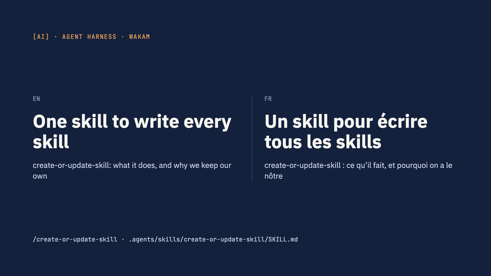

2. The skill market is crowded

   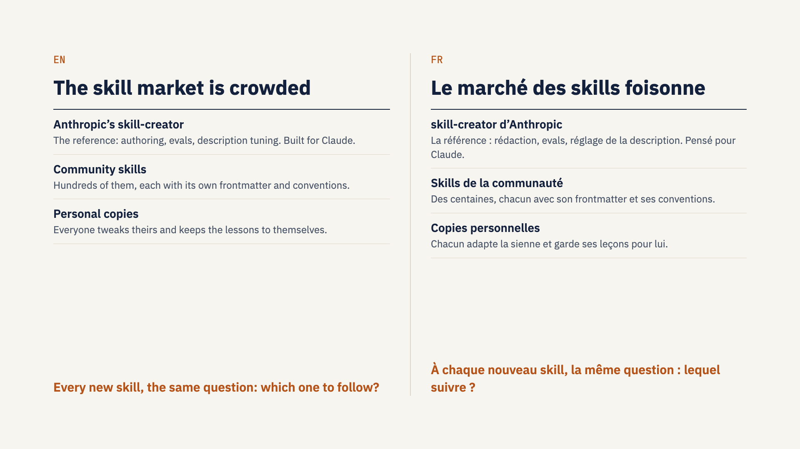

3. What create-or-update-skill does

   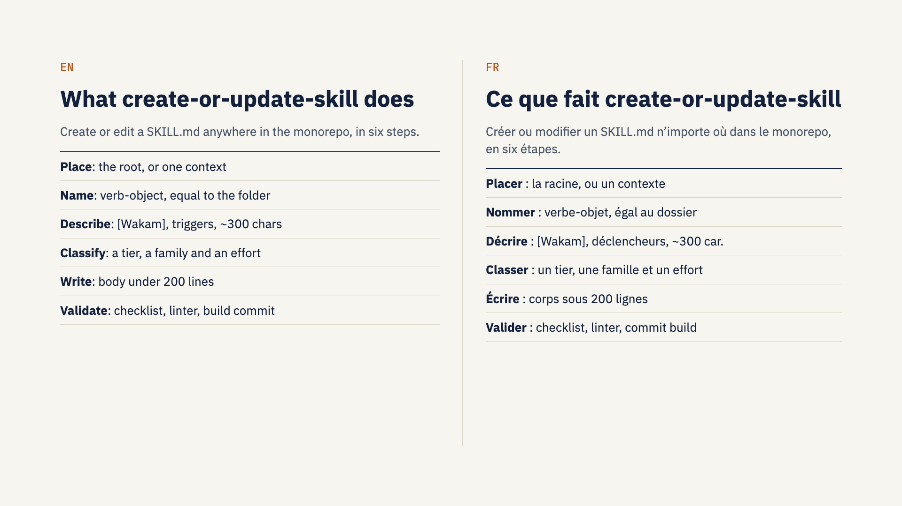

4. Why our own: five reasons

   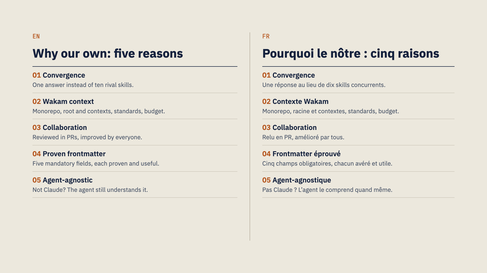

5. Convergence: a mix, not a choice

   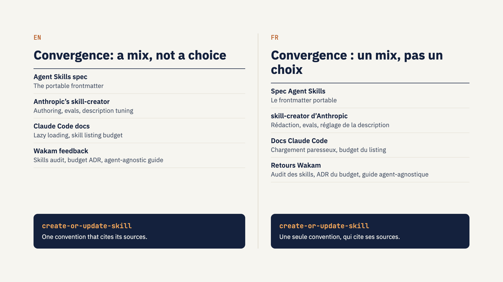

6. Fitted to Wakam

   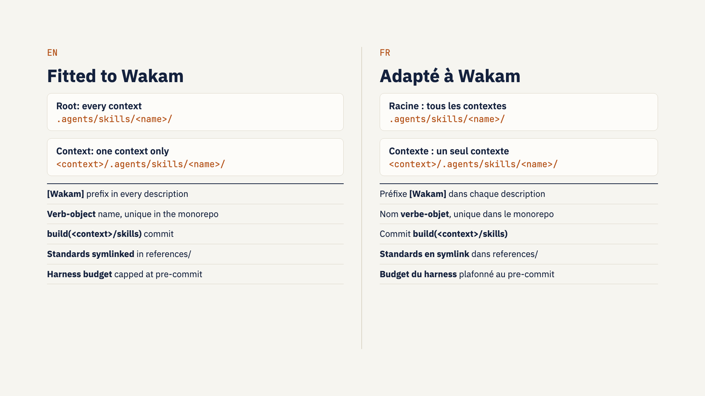

7. In the monorepo, we improve it together

   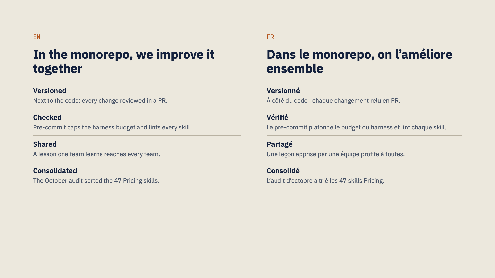

8. Mandatory fields: use, pros, cons

   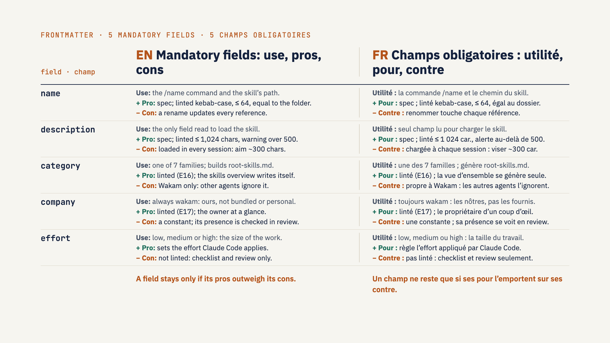

9. Optional fields: use, pros, cons

   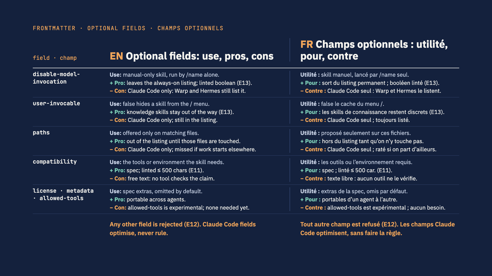

10. Agent-agnostic

    

11. Invocable by any agent: three tiers

    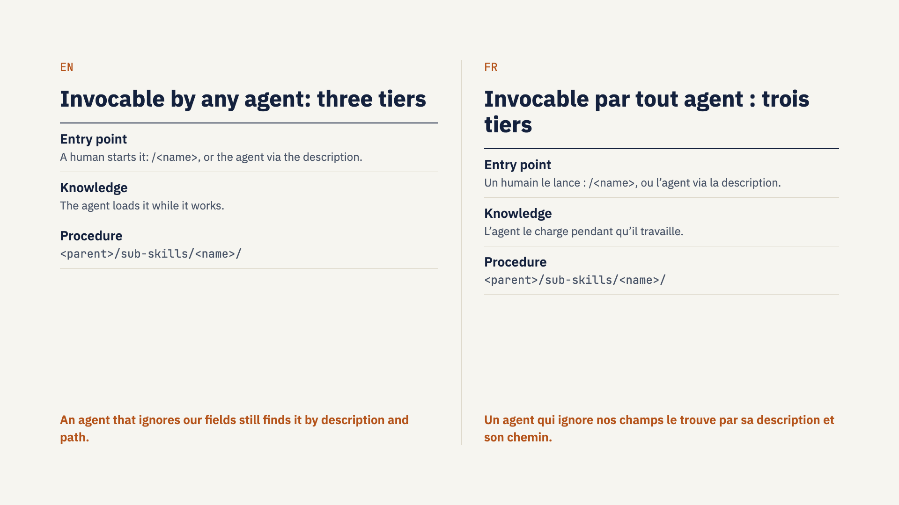

12. Takeaway

    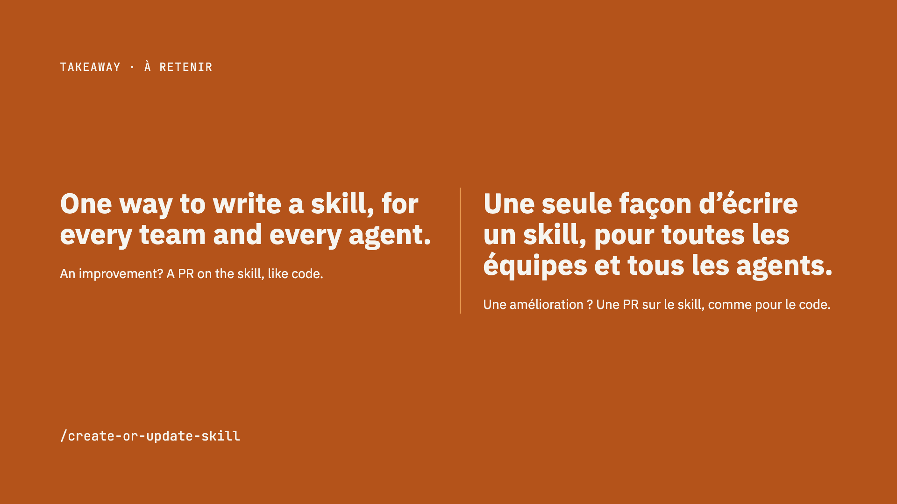

## Limits checked against the tooling

The skills linter is `Pricing/.agents/scripts/validate-skills.py`; the pre-commit hook runs it on Pricing skills (`pricing-skills-lint`) and on root skills (`monorepo-skills-lint`).

| Limit                                   | Where it is enforced                                                                                              |
| --------------------------------------- | ----------------------------------------------------------------------------------------------------------------- |
| `name` ≤ 64 chars, equal to its folder  | skills linter (E4)                                                                                                |
| `description` ≤ 1,024 chars             | skills linter (E5) and `Pricing/.agents/scripts/harness-budget.sh` (Pricing scope), from `description-limits.env` |
| `description` over 500 chars            | skills linter warning (W1), from `description-limits.env`                                                         |
| `description` aim ~300 chars            | convention only (`create-or-update-skill` checklist)                                                              |
| `category` one of seven families        | skills linter (E16); a root skill without one also fails `monorepo-skills-overview`                               |
| `company` equal to `wakam`              | skills linter (E17)                                                                                               |
| `effort` low, medium or high            | convention only (`create-or-update-skill` checklist)                                                              |
| Any field outside the allowed list      | skills linter (E12)                                                                                               |
| Body < 200 lines                        | convention only; `harness-budget.sh` warns past 500 lines or 5,000 tokens (Pricing scope)                         |
| Always-on harness ≤ 15,000 tokens/app   | `harness-budget.sh` pre-commit, root and Pricing nodes                                                            |
| ≤ 500 always-on tokens moved per commit | `harness-budget.sh` pre-commit, root and Pricing nodes                                                            |

The linter checks the value of `category` and `company` when present; the presence of `category`, `company` and `effort` is checked by the checklist and review.
