# Presentation: the create-pr skill

Date: 2026-11-12 · Length: 10 minutes · Audience: the Pricing team and everyone reviewing its PRs · Language: English on the left, French on the right, or English title with its French line under it.

Why Pricing opens every PR through one skill, a Pricing skill (`Pricing/.agents/skills/`), not a monorepo root one, owned and read by every agent rather than each vendor's own PR habits: one PR shape, four scores predicted from the diff against written thresholds (Impact, Safety, Confidence, Debt) so the reviewer knows where to look before reading, and automatic labels on every PR. The skill itself lives at `Pricing/.agents/skills/create-pr/SKILL.md`.

## Slides

| #   | Slide                          | Minutes |
| --- | ------------------------------ | ------- |
| 1   | Cover                          | 0.5     |
| 2   | Why a PR skill in Pricing      | 1       |
| 3   | Why own it, for every agent    | 1       |
| 4   | From the diff to a scored PR   | 0.5     |
| 5   | Anatomy of a PR                | 1       |
| 6   | Four predicted scores          | 1       |
| 7   | Every point has a written rule | 1       |
| 8   | Debt is computed, not guessed  | 1       |
| 9   | A real PR, scored              | 1       |
| 10  | In practice: 49 PRs            | 1       |
| 11  | Why trust the scores           | 0.5     |
| 12  | Takeaway                       | 0.5     |

1. Cover

   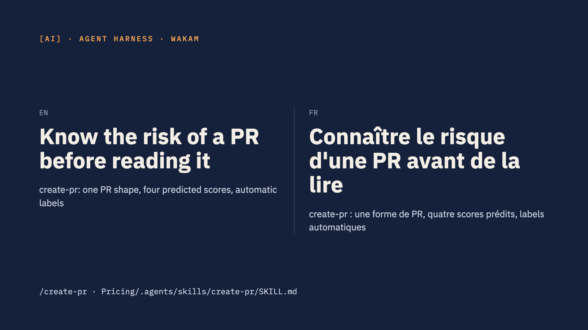

2. Why a PR skill in Pricing

   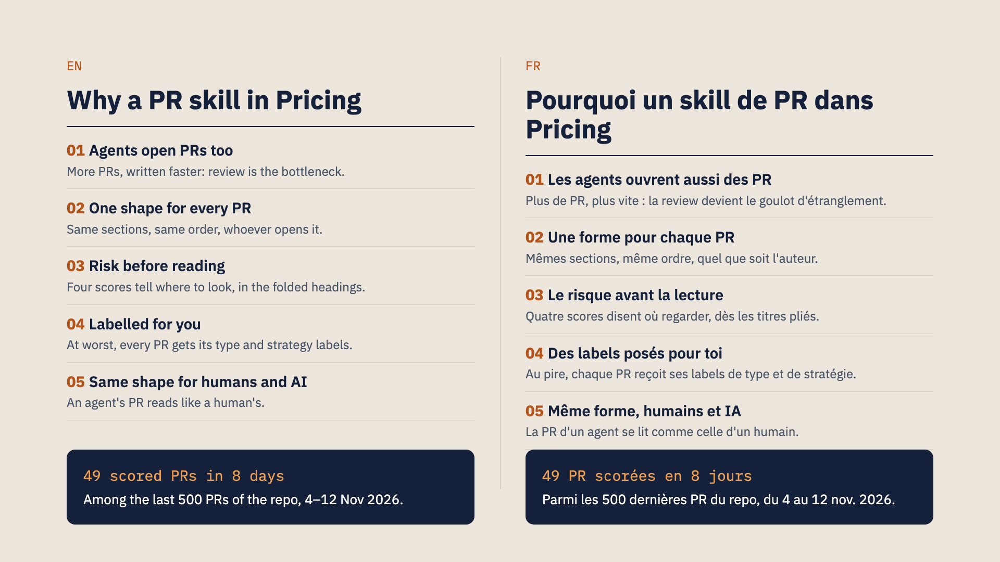

3. Why own it, for every agent

   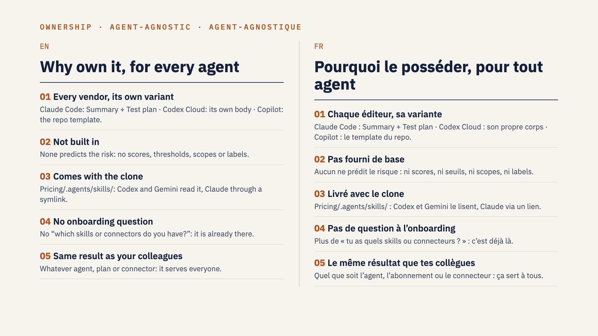

4. From the diff to a scored PR

   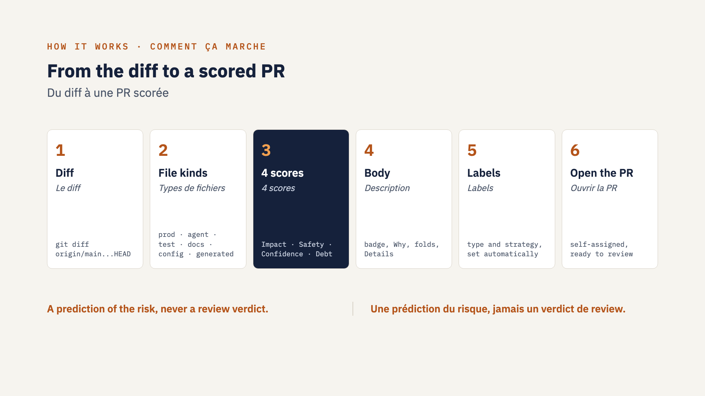

5. Anatomy of a PR

   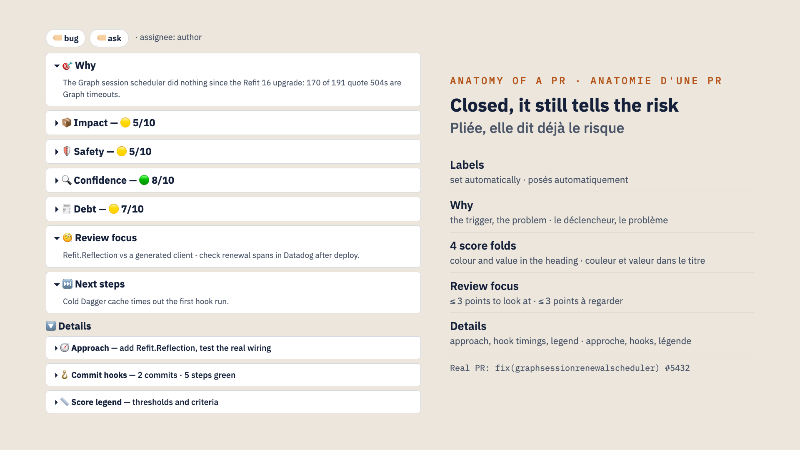

6. Four predicted scores

   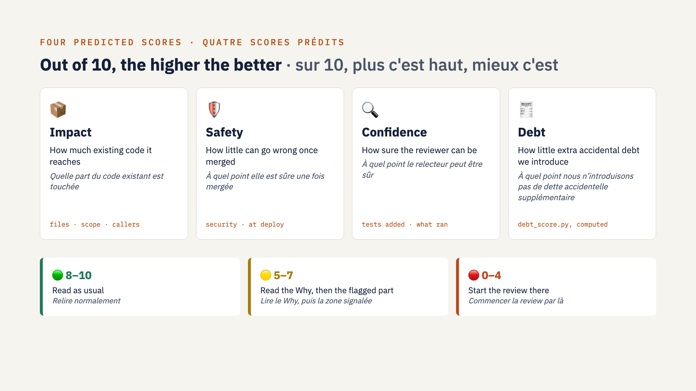

7. Every point has a written rule

   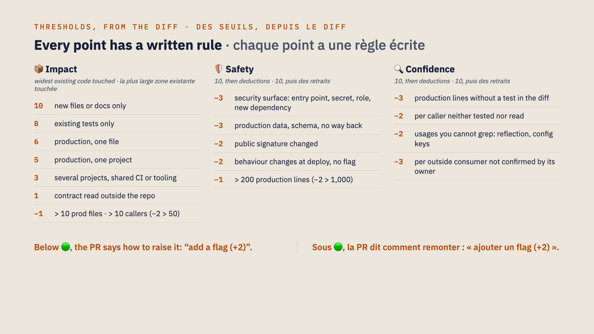

8. Debt is computed, not guessed

   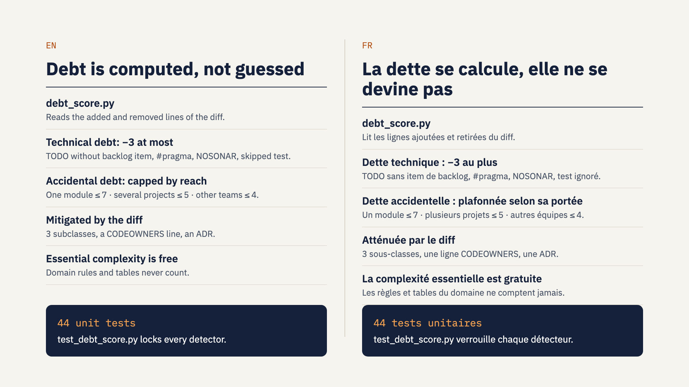

9. A real PR, scored

   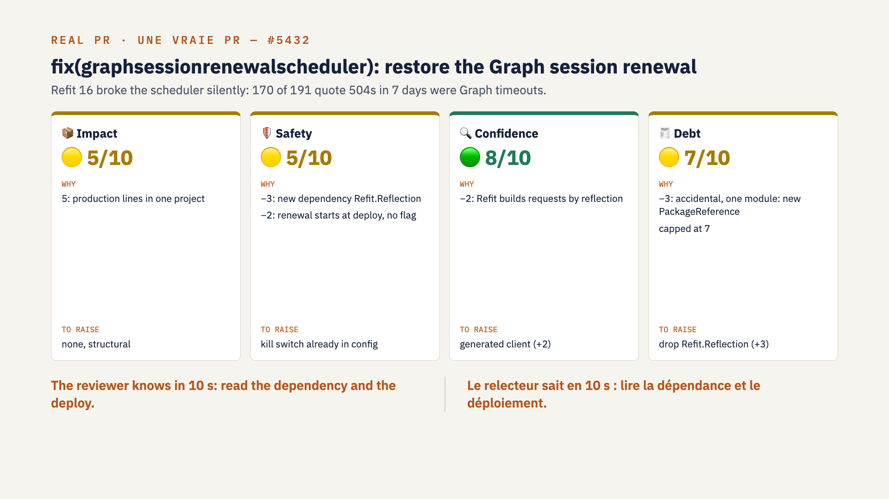

10. In practice: 49 PRs

    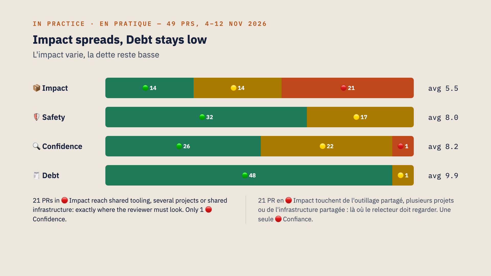

11. Why trust the scores

    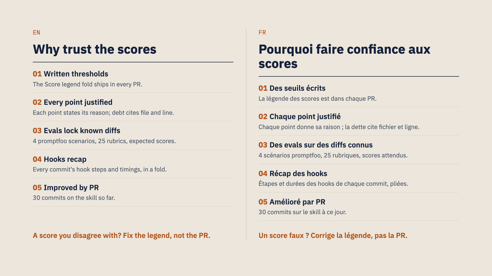

12. Takeaway

    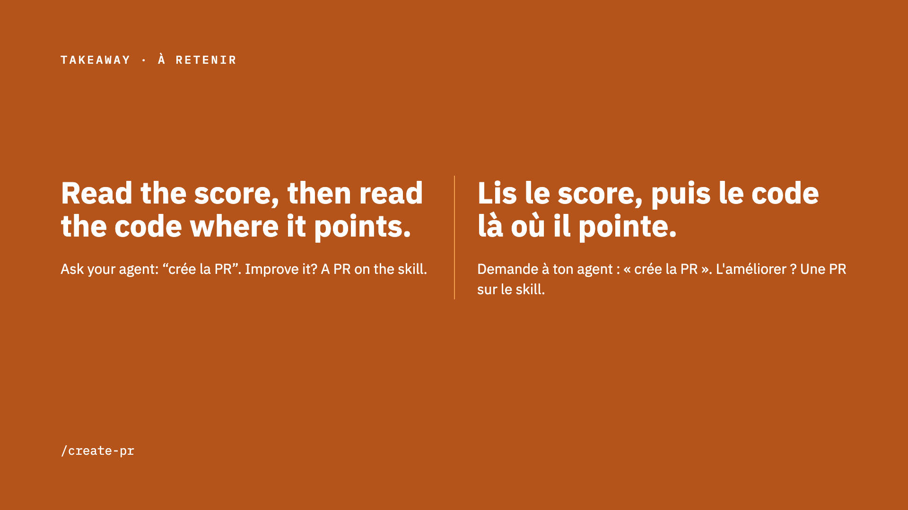

## Sources of the numbers

The thresholds and criteria are those of `Pricing/.agents/skills/create-pr/references/score-legend.md`. The reading guide of slide 6 (what to do with a 🟡 or a 🔴) is a suggestion of this deck, not a rule of the skill.

| Figure                          | Source                                                                                                                       |
| ------------------------------- | ---------------------------------------------------------------------------------------------------------------------------- |
| 49 scored PRs, 4–12 Nov 2026    | the last 500 PRs of `wakam/Wakam` (`gh pr list --state all --limit 500`), those whose body holds a `Confidence —` fold       |
| Score distribution and averages | the score in each fold heading of those 49 PRs                                                                               |
| Real PR                         | [#5432](https://wakam.ghe.com/wakam/Wakam/pull/5432), `fix(graphsessionrenewalscheduler): restore the Graph session renewal` |
| 44 unit tests                   | `test_*` functions of `scripts/tests/test_debt_score.py`                                                                     |
| 4 eval scenarios, 25 rubrics    | `evals/promptfoo.yaml`                                                                                                       |
| 30 commits on the skill         | `git log --oneline -- Pricing/.agents/skills/create-pr`                                                                      |

## Vendor practices behind slide 3

Checked on 2026-11-12; vendor features move fast, so re-check before presenting.

| Agent                | PR description it writes by default                                                                                                                                               |
| -------------------- | --------------------------------------------------------------------------------------------------------------------------------------------------------------------------------- |
| Claude Code          | `/commit-push-pr` (commit-commands plugin): Summary bullets and a Test plan checklist                                                                                             |
| Codex Cloud          | its own body: its Create PR button skips `gh pr create`, so the repository PR template is not applied ([openai/codex#6750](https://github.com/openai/codex/issues/6750))          |
| GitHub Copilot agent | follows the repository's `pull_request_template.md` ([changelog, 2025-11-05](https://github.blog/changelog/2025-11-05-copilot-coding-agent-now-supports-pull-request-templates/)) |
| Gemini CLI           | no PR-writing convention found; its GitHub Action and extensions review PRs                                                                                                       |

None predicts the risk of the change: the four scores, their thresholds, the Pricing commit scopes and the labels come only from `create-pr`. Codex and Gemini CLI read `.agents/skills/` natively, Claude through the `.claude/skills` symlink.
