# Presentation: the illustrate-it skill

Date: 2026-11-12 · Length: 10 minutes · Audience: every team writing docs, ADRs, specs or PRs in the monorepo · Language: English on the left, French on the right, or English title with its French line under it.

Why the monorepo keeps and owns one illustration skill that every agent reads (each vendor ships its own variant, and none illustrates the Wakam way out of the box), how it turns a request into a picture, and every kind of picture it draws, each shown with the template it ships. The skill itself lives at `.agents/skills/illustrate-it/SKILL.md`.

## Slides

| #   | Slide                                   | Minutes |
| --- | --------------------------------------- | ------- |
| 1   | Cover                                   | 0.5     |
| 2   | Why one skill for the monorepo          | 1       |
| 3   | Why own it, for every agent             | 1       |
| 4   | How it works: seven steps               | 1       |
| 5   | The reader's question picks the picture | 0.5     |
| 6   | Gallery 1: structure and flow           | 1       |
| 7   | Gallery 2: states, data, modelling      | 1       |
| 8   | Gallery 3: time, trade-offs, numbers    | 1       |
| 9   | Gallery 4: beyond Mermaid               | 1       |
| 10  | Readable on black and white             | 1       |
| 11  | Checked, not hoped                      | 0.5     |
| 12  | Takeaway                                | 0.5     |

1. Cover

   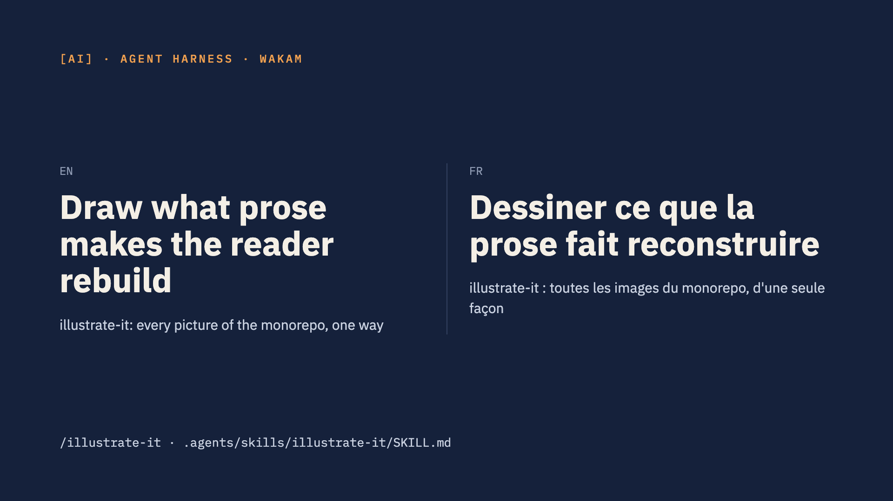

2. Why one skill for the monorepo

   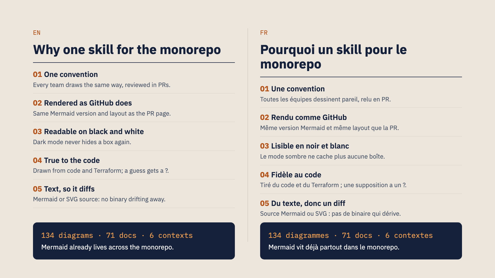

3. Why own it, for every agent

   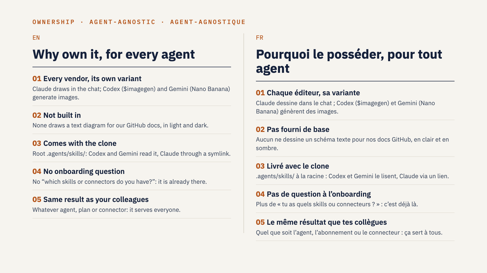

4. How it works: seven steps

   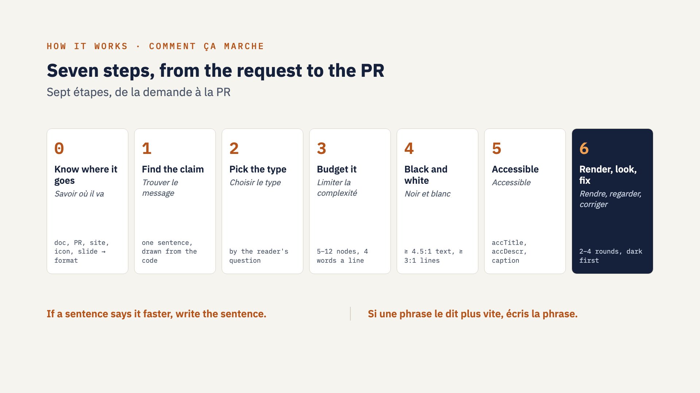

5. The reader's question picks the picture

   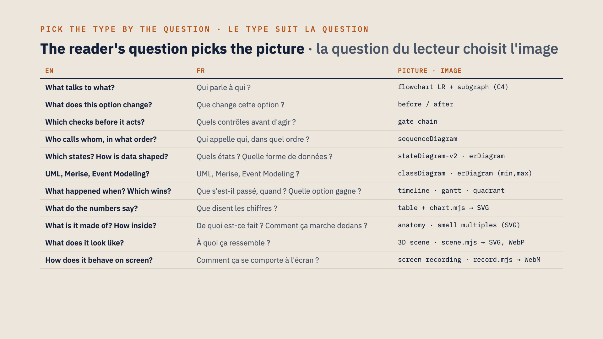

6. Gallery 1: structure and flow

   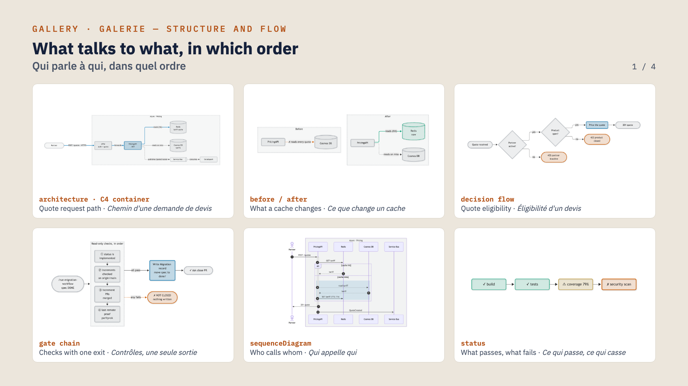

7. Gallery 2: states, data, modelling

   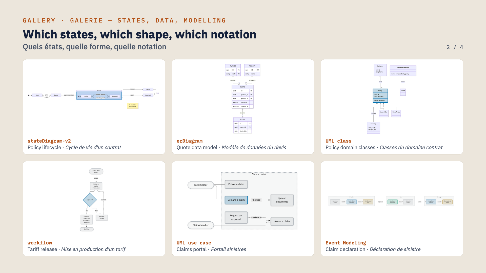

8. Gallery 3: time, trade-offs, numbers

   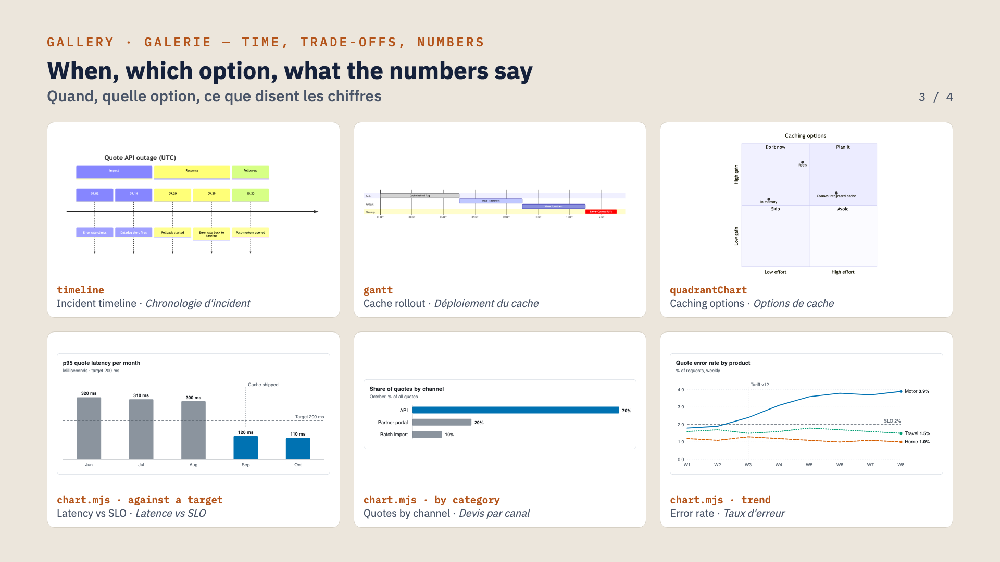

9. Gallery 4: beyond Mermaid

   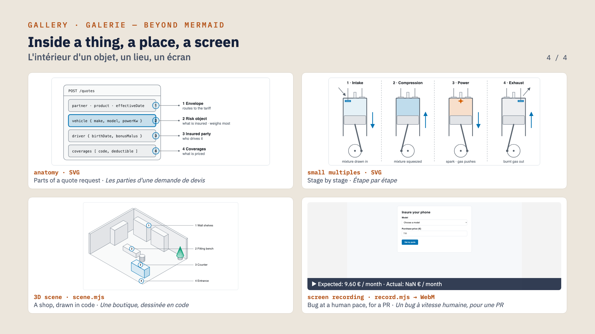

10. Readable on black and white

    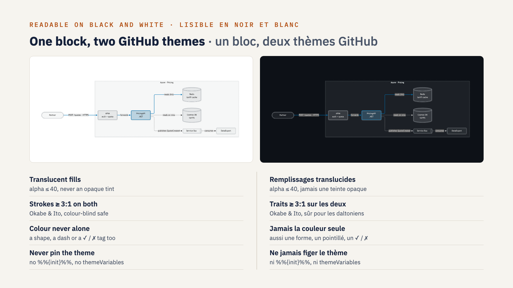

11. Checked, not hoped

    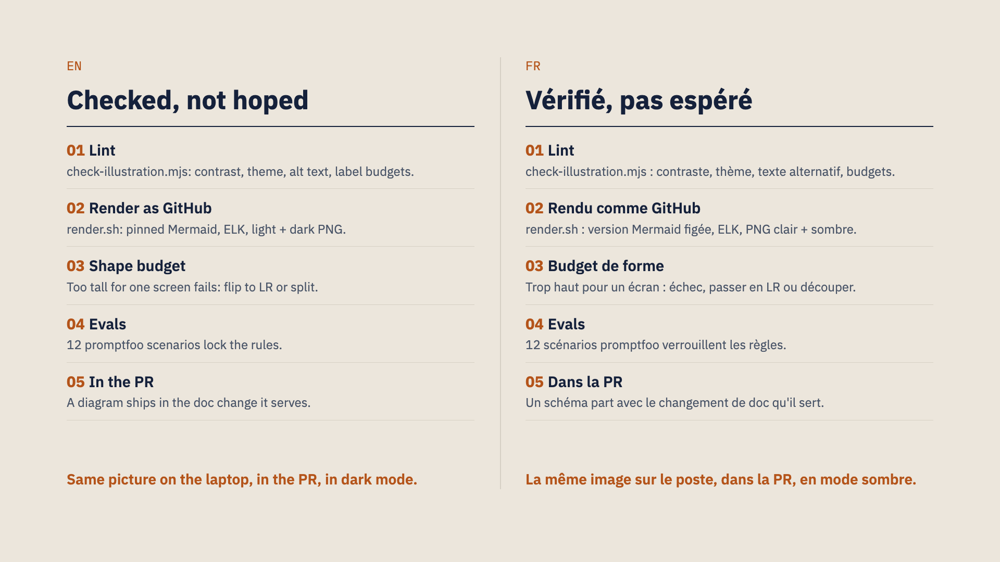

12. Takeaway

    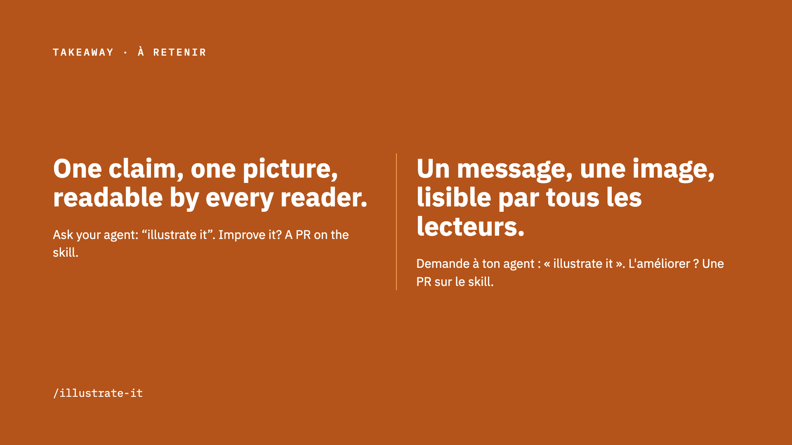

## Sources of the examples and numbers

Every gallery picture is a template of the skill, rendered with its own `scripts/render.sh` (Mermaid, light theme) or its own SVG, under `.agents/skills/illustrate-it/references/patterns/`. The screen recording shows the page of `recordings/quote-form.json`.

| Figure                                 | Source                                                             |
| -------------------------------------- | ------------------------------------------------------------------ |
| 134 Mermaid diagrams in 71 docs        | `git grep -c '```mermaid' -- '*.md'` on `main`, 2026-11-12         |
| 6 contexts                             | top-level folders holding those docs                               |
| 12 eval scenarios                      | `.agents/skills/illustrate-it/evals/promptfoo.yaml`                |
| Pinned Mermaid, ELK layout, `neo` look | `scripts/render.sh`, `scripts/github-mermaid-config.json`          |
| Contrast ≥ 4.5:1 text, ≥ 3:1 lines     | `SKILL.md` section 4, enforced by `scripts/check-illustration.mjs` |

## Vendor practices behind slide 3

Checked on 2026-11-12; vendor features move fast, so re-check before presenting.

| Vendor            | Creating a skill                                                                                                                         | Drawing                                                                                        | Reads `.agents/skills/`                                                    |
| ----------------- | ---------------------------------------------------------------------------------------------------------------------------------------- | ---------------------------------------------------------------------------------------------- | -------------------------------------------------------------------------- |
| Anthropic, Claude | its own `skill-creator` and [authoring best practices](https://platform.claude.com/docs/en/agents-and-tools/agent-skills/best-practices) | Artifacts and inline visuals in the chat (Mermaid, HTML, SVG), not files a GitHub doc renders  | through the `.claude/skills` symlink                                       |
| OpenAI, Codex     | built-in [`$skill-creator`](https://developers.openai.com/codex/skills/create-skill), optional `agents/openai.yaml`                      | built-in `$imagegen` skill: generated raster images                                            | [natively](https://developers.openai.com/codex/skills), or `.codex/skills` |
| Google, Gemini    | built-in [`skill-creator`](https://geminicli.com/docs/cli/creating-skills/)                                                              | [Nano Banana extension](https://github.com/gemini-cli-extensions/nanobanana): generated images | as an alias of `.gemini/skills`                                            |

None draws a text diagram that diffs, renders on GitHub and holds in light and dark mode: that is what `illustrate-it` adds, and why it forbids model-generated images.
