# Presentation: the Veblen effect

Date: 2026-11-19 · Length: 10 minutes · Audience: jeudev, the Pricing team · Language: English title with its French line under it, body in French.

Why some goods sell more when their price goes up, where the effect comes from, when it breaks, what it means for an insurer's pricing, and, to close, how the snob effect differs from it. Design: Wakam design system (`PartnerPortal/app/app.css`: Poppins, `--primary`, `--brand-orange`, `--navy`).

Each slide reads without the speaker: its title states the message, a sentence on the slide explains the picture, and every figure carries its source. Below, each slide comes with its message in text, for readers who do not see the image.

## Accessibility

- Text contrast is at least 4.5:1, or 3:1 for large text (24 px and up, or 19 px bold and up); no text sits in brand orange, which only marks shapes.
- No text is smaller than 26 px on a 1920 × 1080 slide.
- No information relies on colour alone: every coloured mark has a word next to it.
- In `slides.html`, each slide is a labelled region, English titles carry `lang="en"`, and each meaningful drawing has `role="img"` with a French description; decorative drawings are hidden from screen readers.

## Slides

| #   | Slide                               | Minutes |
| --- | ----------------------------------- | ------- |
| 1   | Cover                               | 0.25    |
| 2   | Same bag, two price tags            | 1       |
| 3   | Demand that climbs with price       | 1       |
| 4   | 1899: conspicuous consumption       | 0.75    |
| 5   | A loop that feeds itself            | 0.75    |
| 6   | Chanel 2.55: every price rise sells | 1       |
| 7   | Air Dior, 2020                      | 1       |
| 8   | The price tag changes the taste     | 0.75    |
| 9   | It works… until it doesn't          | 0.75    |
| 10  | Insurance is not a handbag          | 1.25    |
| 11  | The snob effect                     | 1       |

1. Cover

   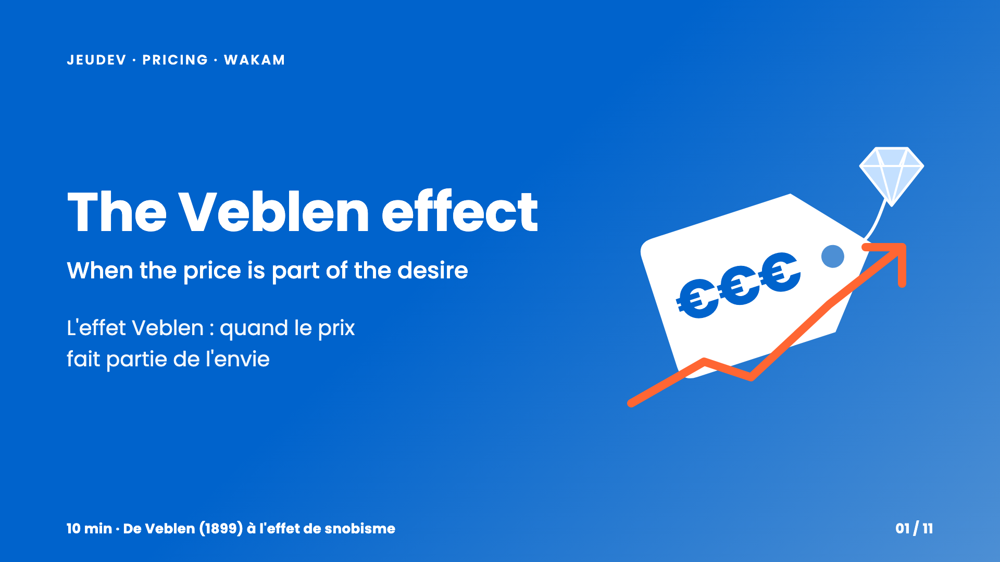

   L'effet Veblen : quand le prix fait partie de l'envie.

2. Same bag, two price tags

   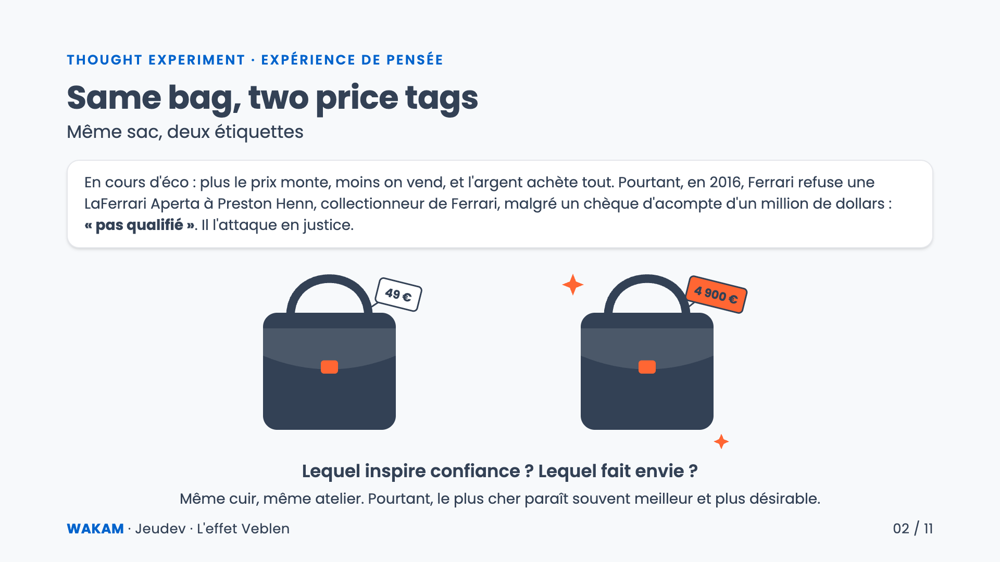

   En cours d'éco : plus le prix monte, moins on vend, et l'argent achète tout. Pourtant, en 2016, Ferrari refuse une LaFerrari Aperta à Preston Henn, collectionneur de Ferrari, malgré un chèque d'acompte d'un million de dollars : « pas qualifié ». Il l'attaque en justice.

   Même cuir, même atelier : pourtant le sac le plus cher paraît souvent meilleur et plus désirable.

3. Demand that climbs with price

   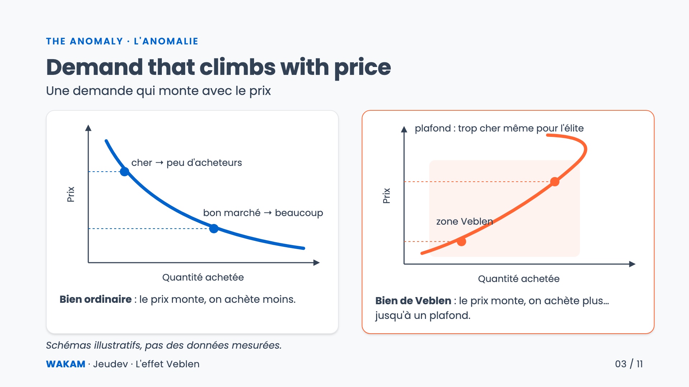

   Bien ordinaire : le prix monte, on achète moins. Bien de Veblen : le prix monte, on achète plus, jusqu'à un plafond. Schémas, pas des données.

4. 1899: conspicuous consumption

   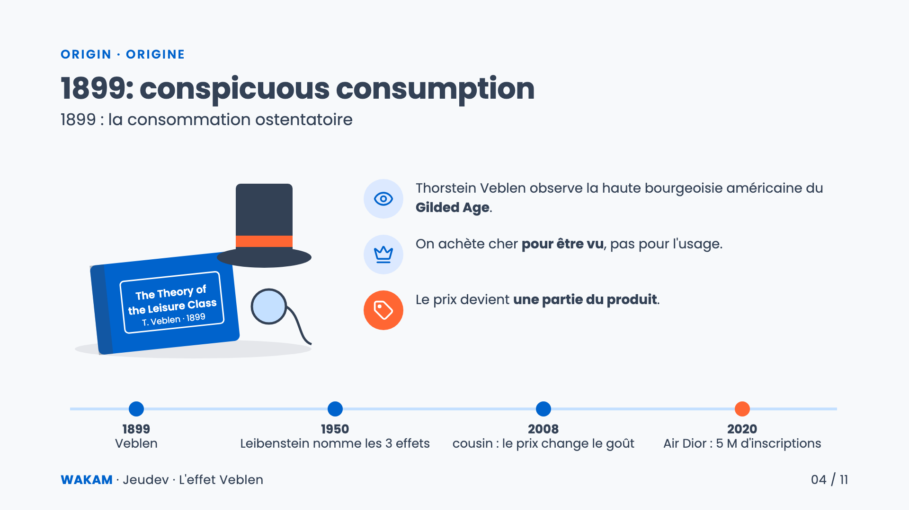

   Thorstein Veblen observe la haute bourgeoisie américaine : on achète cher pour être vu, et le prix devient une partie du produit.

5. A loop that feeds itself

   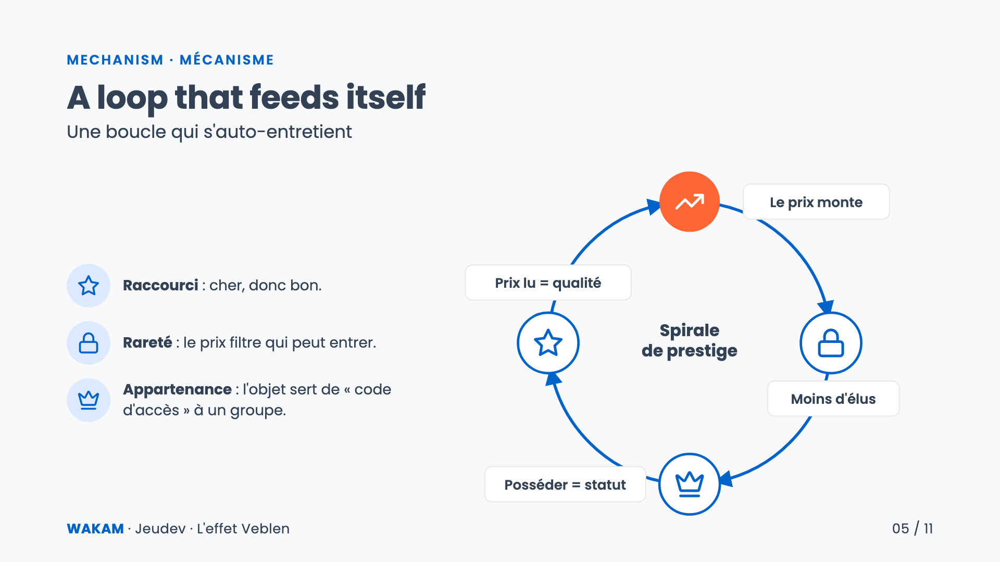

   Raccourci « cher donc bon », rareté filtrée par le prix, appartenance à un groupe : chaque étape nourrit la suivante.

6. Chanel 2.55: every price rise sells

   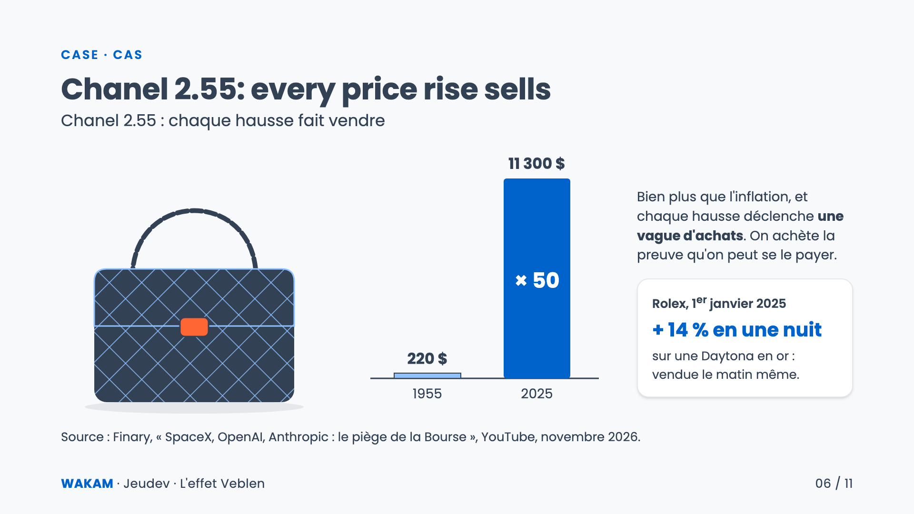

   Le 2.55 coûte plus de 50 fois son prix de 1955, bien au-delà de l'inflation, et chaque hausse déclenche une vague d'achats. Rolex monte une Daytona en or de 14 % en une nuit : elle part le matin même.

7. Air Dior, 2020

   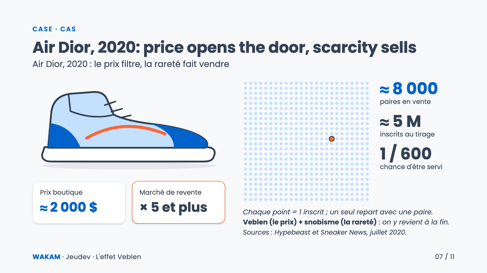

   Le prix sert de ticket d'entrée, la rareté fait la demande : c'est déjà du snobisme, développé à la dernière slide.

8. The price tag changes the taste

   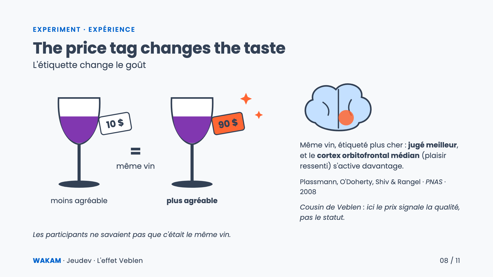

   Le même vin, étiqueté plus cher, est jugé plus agréable et active davantage le cortex orbitofrontal médian. Cousin de Veblen : le prix signale la qualité, pas le statut.

9. It works… until it doesn't

   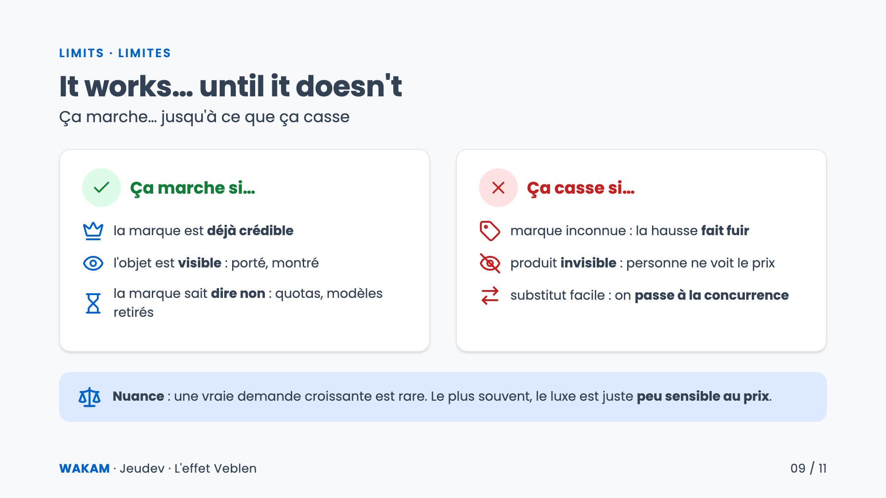

   Une vraie demande croissante est rare : le plus souvent, le luxe est juste peu sensible au prix.

10. Insurance is not a handbag

    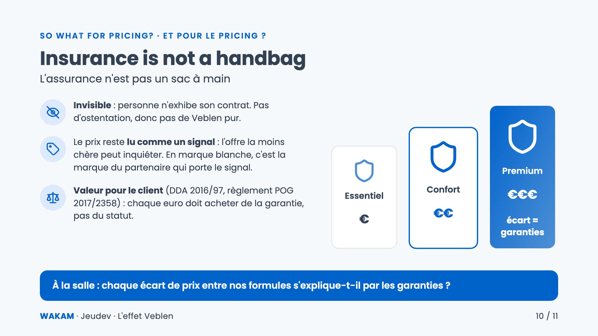

    Personne n'exhibe son contrat : pas de Veblen pur. Le prix reste un signal, porté en marque blanche par la marque du partenaire, et la gouvernance produit exige que chaque euro achète de la garantie.

11. The snob effect

    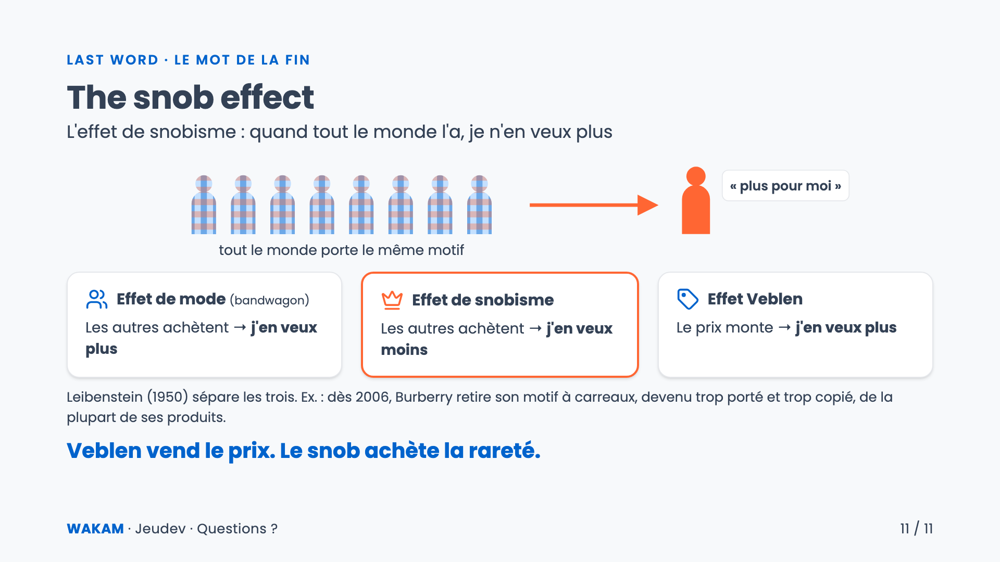

    Leibenstein (1950) sépare les trois effets. Dès 2006, Burberry retire son motif à carreaux, devenu trop porté et trop copié. Veblen vend le prix, le snob achète la rareté.

## Sources

| Claim                                                                                                         | Source                                                                                                                                                                                                                                                    |
| ------------------------------------------------------------------------------------------------------------- | --------------------------------------------------------------------------------------------------------------------------------------------------------------------------------------------------------------------------------------------------------- |
| Starting point of the deck                                                                                    | [Effet de snobisme (Veblen)](https://biais-psychologiques.com/biais/effet-de-snobisme-veblen/), biais-psychologiques.com, 2026-05-10                                                                                                                      |
| Ferrari refuses Preston Henn a LaFerrari Aperta despite a $1 M deposit cheque, 2016; he sues                  | [Jalopnik, 2016-08](https://jalopnik.com/pissed-off-racing-legend-sues-ferrari-for-denying-him-a-1784768746), [Motor Authority, 2016-08](https://www.motorauthority.com/news/1105354_famous-collector-sues-ferrari-after-denial-of-laferrari-convertible) |
| Conspicuous consumption, 1899                                                                                 | Veblen, T. (1899). _The Theory of the Leisure Class_. Macmillan                                                                                                                                                                                           |
| Bandwagon, snob and Veblen effects                                                                            | Leibenstein, H. (1950). Bandwagon, Snob, and Veblen Effects in the Theory of Consumers' Demand. _The Quarterly Journal of Economics_, 64(2), 183–207                                                                                                      |
| Chanel 2.55 at $220 in 1955 and $11,300 in 2025; Rolex Daytona +14 % on 2025-01-01                            | [Finary, « SpaceX, OpenAI, Anthropic : le piège de la Bourse »](https://www.youtube.com/watch?v=cX-uKc8DkpY), YouTube, November 2026                                                                                                                      |
| Same wine rated better at a higher price                                                                      | Plassmann, H., O'Doherty, J., Shiv, B., & Rangel, A. (2008). Marketing actions can modulate neural representations of experienced pleasantness. _PNAS_, 105(3), 1050–1054 ([PMC2242704](https://pmc.ncbi.nlm.nih.gov/articles/PMC2242704))                |
| Air Dior: ≈ 8,000 public pairs (13,000 in all), ≈ 5 M registrations, $2,000–2,200 retail, resale × 5 and more | [Hypebeast, 2020-07](https://hypebeast.com/2020/7/5-million-people-dior-air-jordan-1-og-raffle-chances-stats), [Sneaker News, 2020-07-03](https://sneakernews.com/2020/07/03/jordan-1-dior-registration-information)                                      |
| Burberry pulls its check from most products from 2006                                                         | [Burberry, Wikipedia](https://en.wikipedia.org/wiki/Burberry)                                                                                                                                                                                             |
| Insurance product governance                                                                                  | Directive (EU) 2016/97 (IDD, DDA in French), Delegated Regulation (EU) 2017/2358 (POG)                                                                                                                                                                    |

The source article uses "Veblen effect" and "snob effect" as synonyms; slide 11 follows Leibenstein, who separates them. Its notes 4 and 5 cite papers from 1996 and 2006 for events of 2020 and later: the Air Dior figures come from the press coverage of the release, not from those notes. The Chanel and Rolex figures come from the Finary video only; check them before quoting them outside this talk.

## Questions to expect

| Question                                       | Answer                                                                                                                  |
| ---------------------------------------------- | ----------------------------------------------------------------------------------------------------------------------- |
| Isn't Air Dior scarcity rather than Veblen?    | Both: the price is the entry ticket, scarcity drives the demand; slide 11 names it. Chanel (slide 6) is the price case. |
| Has an upward demand curve ever been measured? | Hardly ever cleanly; luxury mostly shows low price sensitivity (slide 9).                                               |
| Veblen or Giffen?                              | Giffen: an inferior good bought more by poor households, through the income effect. Veblen: status, among the well-off. |
| So we raise the Premium price?                 | No: product governance puts value for the customer first; the signal can explain a gap in cover, never create one.      |
| Did the tasters know it was the same wine?     | No; they did not pay, and the sample was small. Do not quote a sample size.                                             |

## Rendering

`slides.html` is the source; each slide renders to a PNG with headless Chrome:

```bash
for i in $(seq 1 11); do "/Applications/Google Chrome.app/Contents/MacOS/Google Chrome" --headless=new --hide-scrollbars --window-size=1920,1080 --virtual-time-budget=8000 --screenshot="slide-$i.png" "file://$PWD/slides.html#s$i"; done
```
